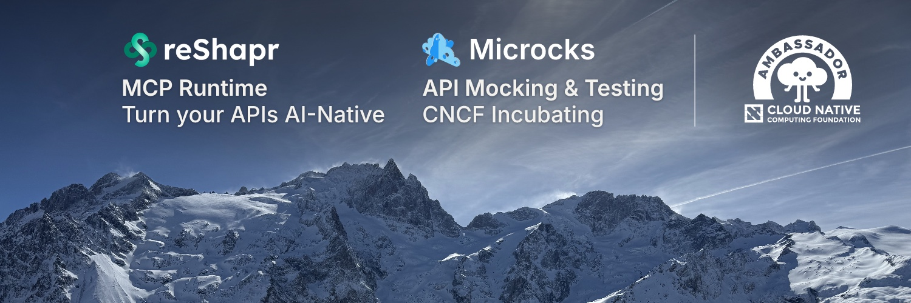

## 👋 Hi, I'm Yacine

I co-founded **[reShapr](https://reshapr.io/)**, the open source MCP runtime that turns your existing APIs into governed MCP tools, and **[Microcks](https://microcks.io/)**, a CNCF Incubating project for API mocking and contract testing, where I'm a core maintainer. I'm also a **CNCF Ambassador**.

Before that: nearly three decades in open source, from early ISP infrastructure and 14 years as an entrepreneur to 6 years at Red Hat. I care about open organization models and helping companies adopt open source and cloud native in practice.

## 🛠️ What I'm building

### 🚀 [reShapr](https://github.com/reshaprio/reshapr)
**Turn your APIs AI-Native, without rebuilding them.**

reShapr is an open source MCP runtime. It turns REST, GraphQL and gRPC APIs into MCP tools with API-key auth, audit, operation filters and trimmed responses, so AI agents get slim, governed tools instead of raw payloads.

### 🧪 [Microcks](https://github.com/microcks/microcks)
**Open source API mocking and testing, CNCF Incubating.**

Microcks is a CNCF Incubating project for API mocking and contract testing. It turns OpenAPI, AsyncAPI, gRPC and GraphQL contracts into live mocks and conformance tests, from a laptop to Kubernetes.

## 🏅 Credentials

<a href="https://certdirectory.io/profile/yacine-kheddache?utm_source=github&utm_medium=readme">
  <picture>
    <source media="(prefers-color-scheme: dark)" srcset="https://certdirectory.io/badge/yacine-kheddache.svg?style=card&theme=dark">
    
  </picture>
</a>

## 📊 Activity

## ⭐ Support my work

> [!IMPORTANT]
> Give [reShapr](https://github.com/reshaprio/reshapr) and [Microcks](https://github.com/microcks/microcks) a ⭐ and share them with friends. Using one of them? Add your organization to their ADOPTERS list.

Mountain lover and craft beer fan, always up for a good climb or a great IPA 🍻

